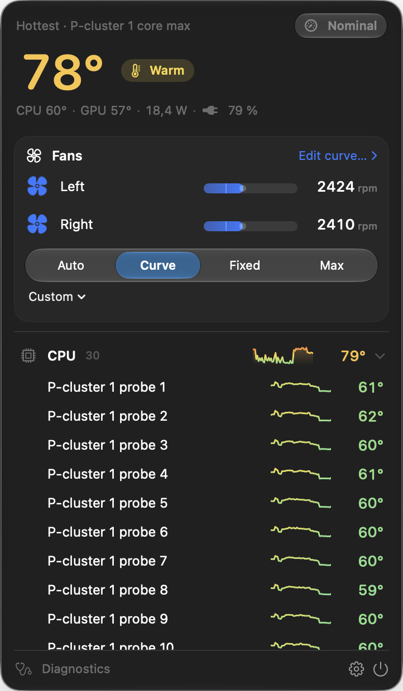
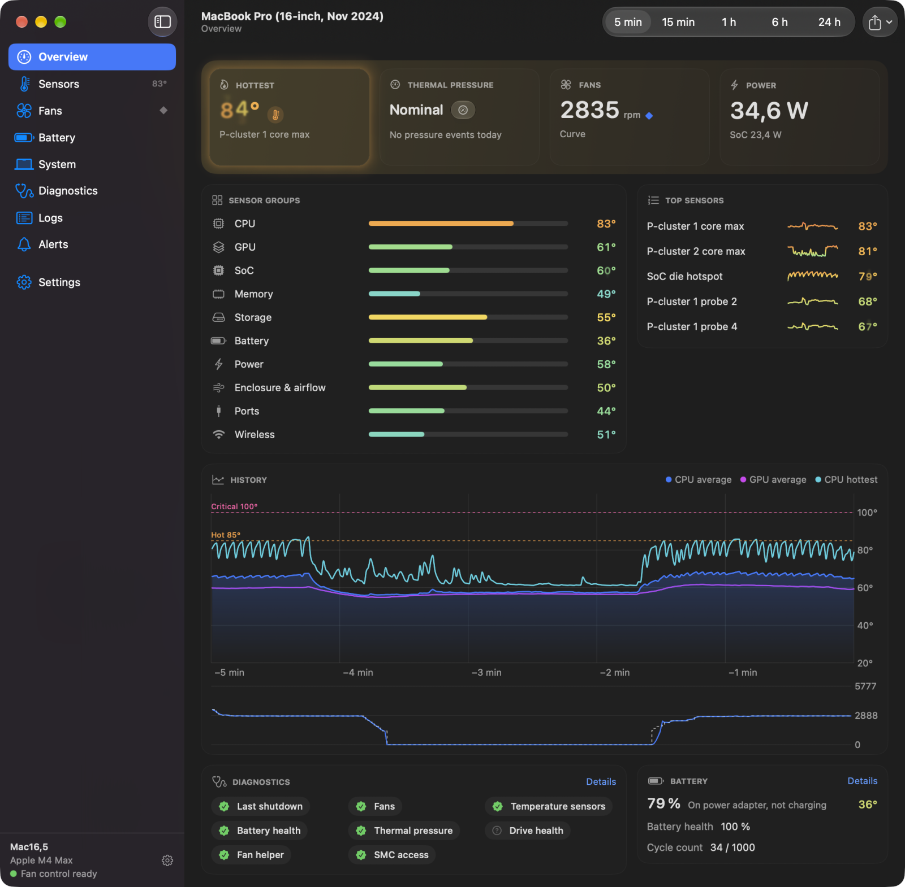
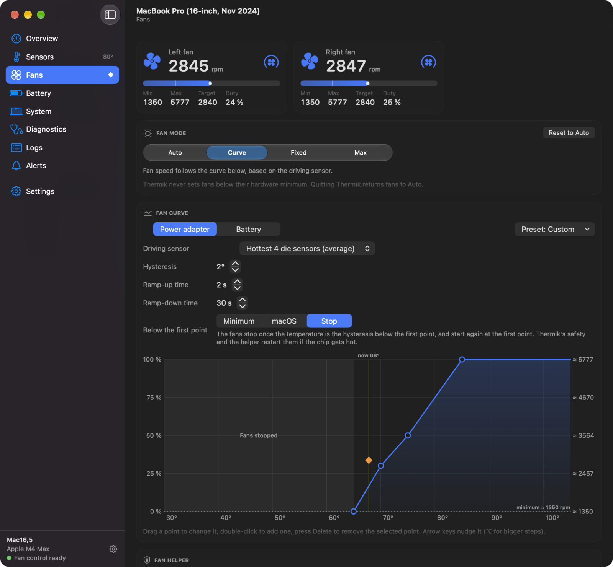
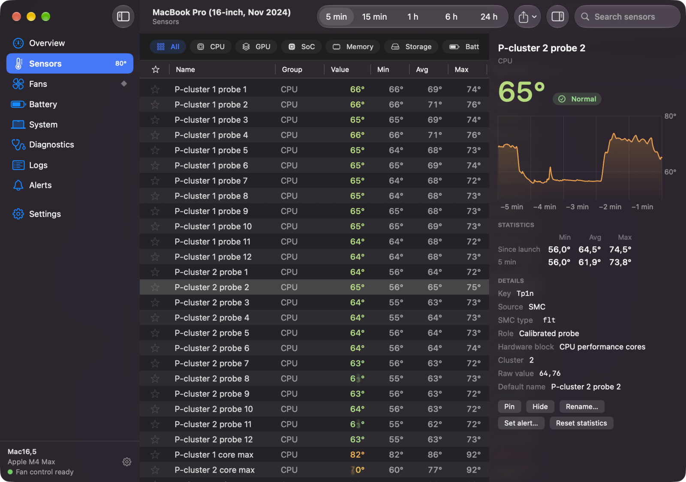
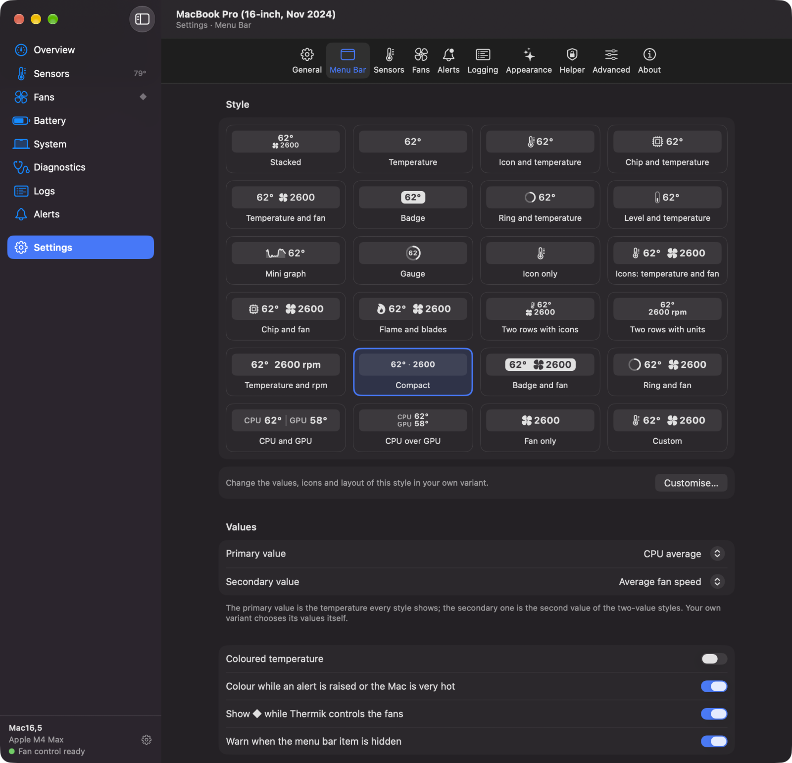
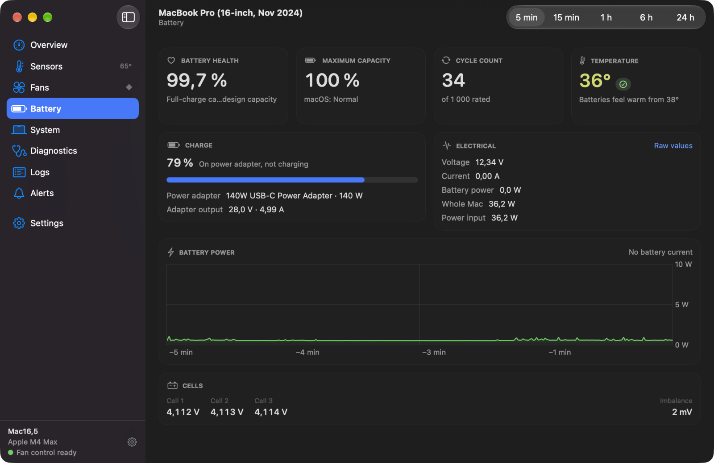
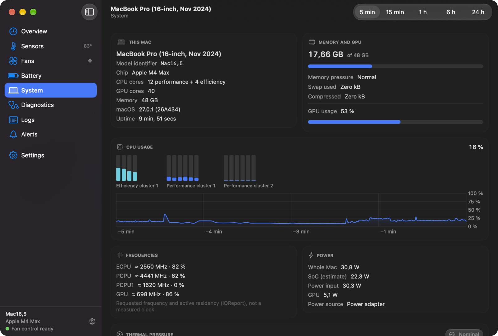
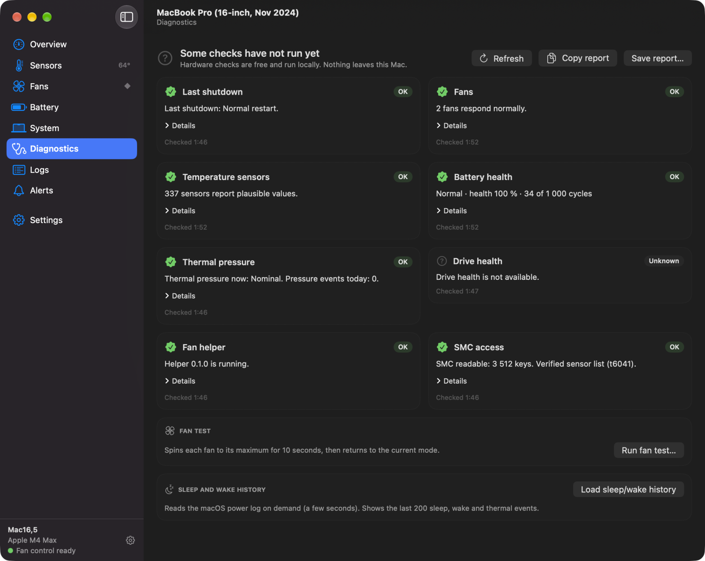
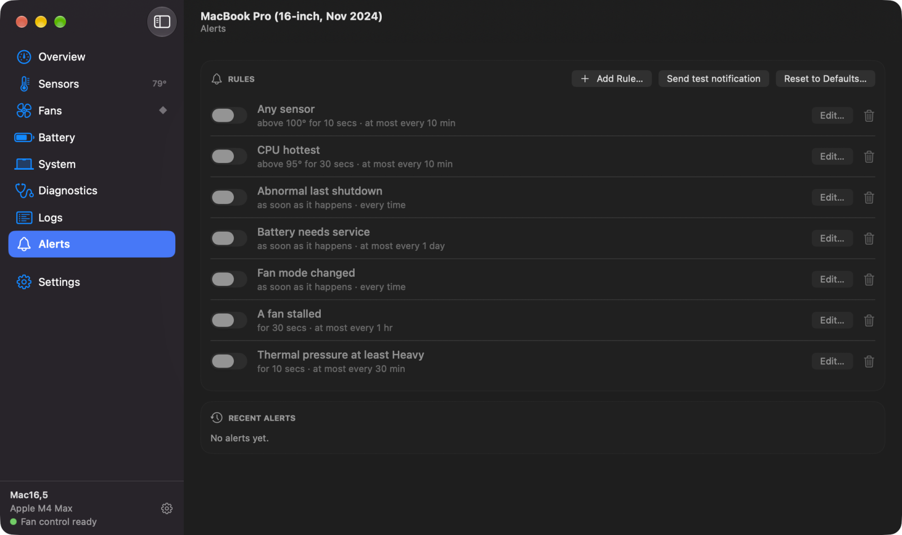
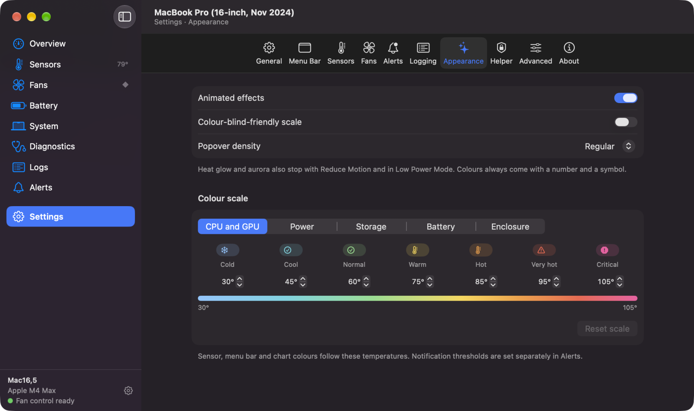

<p align="center">
  
</p>

<h1 align="center">Thermik</h1>

<p align="center">
  <em>See the heat. Ride it calmly.</em><br>
  Temperatures, fans, battery and diagnostics for your Mac, right in the menu bar.
</p>

<p align="center">
  <strong>English</strong> · <a href="README.ru.md">Русский</a>
</p>

<p align="center">
  
  
  
</p>

<p align="center">
  
  &nbsp;
  
</p>

Thermik is a free, open-source menu bar app for macOS. It shows every temperature sensor of your Mac, the fans,
the battery and the system load, and it can take over the fans with a curve you draw yourself. No account, no
telemetry, no network access.

## What it can do

- **Menu bar.** 23 ready-made label styles, or build your own from up to four values. One click opens a panel
  with every sensor, the fans and the fan modes.
- **Fan control.** Auto, Curve, Fixed and Max. Drag the points of the curve, start from a preset (Quiet,
  Balanced, Cool, Performance), keep a separate curve for battery power, and even stop the fans completely
  when the Mac is cool (Apple Silicon).
- **Sensors.** Every SMC and HID sensor, grouped and searchable: about 85 on an M4 Max, over 300 with
  "Show hidden sensors". History from 5 minutes to 24 hours is kept in memory while Thermik runs.
  Pin, hide or rename any of them, and export the history to CSV or JSON.
- **Battery and system.** Battery health, cycles, cell voltages and the power adapter. Per-core CPU load, GPU,
  memory, frequencies and where the watts go.
- **Diagnostics.** Eight local checks (last shutdown, fans, sensors, battery, SSD, thermal pressure and more)
  and a report you can paste into a bug report, with serial numbers and other identifiers removed.
- **Alerts and logs.** Your own notification rules (threshold, duration, repeat limit, optional "fans to Max"),
  an event log and an optional CSV log.
- **Automation.** Shortcuts actions, `thermik://` links and global hotkeys ([details](docs/automation.md)).
- English and Russian, °C and °F, Liquid Glass on macOS 26.

## A closer look

### Fans

Pick a mode for all fans at once. In Curve mode the fans follow the sensor you choose: the four hottest die
sensors, the GPU, the SSD or any single sensor. The vertical "now" line and the orange diamond show where you
are right now.

<p align="center"></p>

### Sensors

Every sensor with its live value, minimum, average, maximum and a 5-minute sparkline. The inspector on the right
shows the history and the technical details of the selected sensor.

<p align="center"></p>

### Your menu bar, your way

Each style is previewed with your Mac's live readings. "Custom" lets you combine any sensors, fans or power,
with a choice of icons and short captions (up to four characters).

<p align="center"></p>

### Battery and system

<p align="center">
  
  
</p>

### Diagnostics

Checks run locally and explain what they found in plain words. There is also a 10-second fan test and the macOS
sleep and wake history.

<p align="center"></p>

### Alerts and colours

Seven ready-made alert rules, all off until you turn one on. Every temperature is coloured on a scale you can
adjust, and there is a colour-blind-friendly scale.

<p align="center">
  
  
</p>

## Safe by design

- Monitoring needs no permissions. Only fan control needs a small open-source helper, installed with one
  administrator password prompt.
- When Thermik quits, crashes, hangs or the Mac goes to sleep, the fans go back to macOS.
- In Curve, Fixed and Max, the fans jump to full speed when the four hottest die sensors average 100 °C (or any
  one of them reaches 105 °C). The helper has its own backstop that works even if the app freezes.
- Thermik never fights another fan-control app: it switches to Auto and tells you which app is in charge when it
  can identify it.
- Every launch starts in Auto unless you turn on "Restore the last fan mode when Thermik starts".

## Getting Thermik

Thermik runs on macOS 14 or later. Download `Thermik-<version>.dmg` from the [latest release](../../releases/latest),
open it and drag Thermik.app to Applications (or take `Thermik-<version>.zip`, unzip it and move Thermik.app there).
The app is ad-hoc signed, not notarized, so macOS blocks its first launch: open it once, then allow it in System
Settings › Privacy & Security › Open Anyway.

To build it from source instead, you need Xcode 27.1 or later and [XcodeGen](https://github.com/yonaskolb/XcodeGen)
2.46.0 or later.

```sh
brew install xcodegen
scripts/lib/build.sh Release
open build/DerivedData/Build/Products/Release/Thermik.app
```

No Apple developer account is needed. To look around without touching the hardware, start it in demo mode:
`open …/Thermik.app --args -ThermikDemo YES`. Everything else about building, signing and the helper is in the
[developer guide](docs/development.md).

## Status

Thermik is in active development. Verified sensor names ship for Apple M4 Max. Other Apple Silicon Macs
work with approximate sensor names, and Intel Macs are best effort. Bug reports with the Diagnostics report
attached are very welcome.

## Privacy

Thermik has no telemetry, no analytics and no network code at all. Sensor data, settings and logs stay on your
Mac.

## Legal

Thermik is an independent project. It is not affiliated with, endorsed by or derived from Tunabelly Software or
TG Pro. It is written clean-room: no code or resources from any proprietary app were used.

[MIT](LICENSE) © 2026 Thermik contributors.
