<p align="center">
  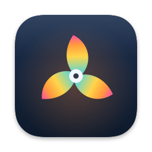
</p>

<h1 align="center">Thermik</h1>

<p align="center">
  <em>Видеть тепло. Сохранять спокойствие.</em><br>
  Температуры, вентиляторы, аккумулятор и диагностика Mac — прямо в строке меню.
</p>

<p align="center">
  <a href="README.md">English</a> · <strong>Русский</strong>
</p>

<p align="center">
  
  
  
</p>

<p align="center">
  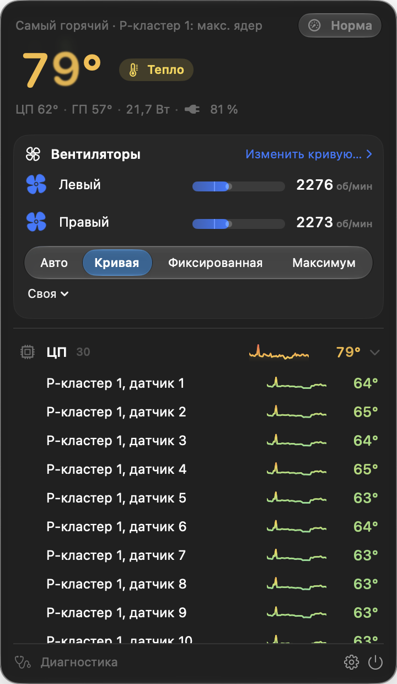
  &nbsp;
  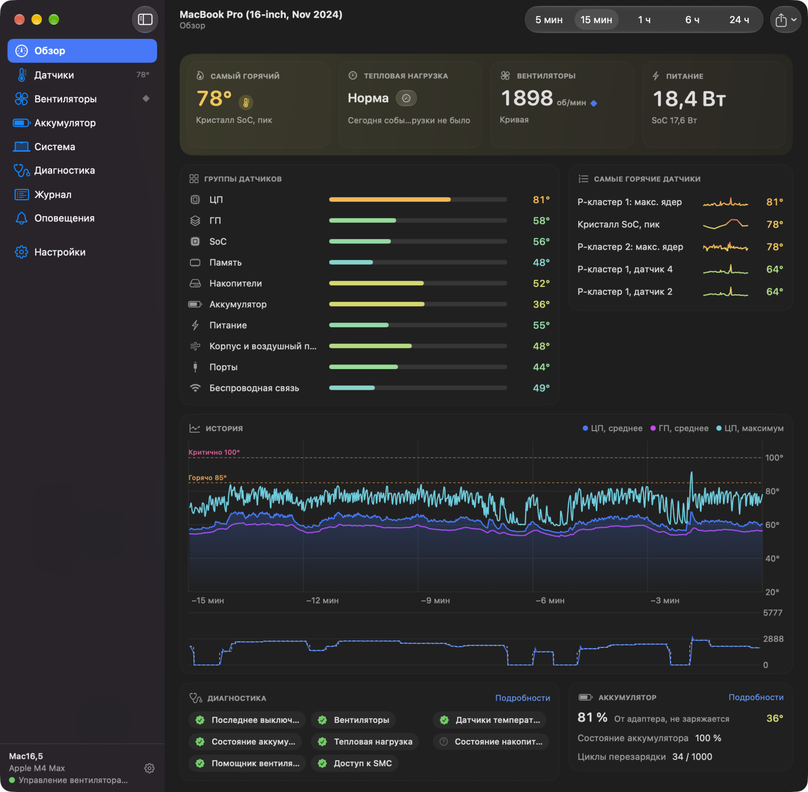
</p>

Thermik — бесплатное приложение с открытым исходным кодом для строки меню macOS. Оно показывает все датчики
температуры вашего Mac, вентиляторы, аккумулятор и нагрузку на систему, а ещё умеет управлять вентиляторами по
кривой, которую вы рисуете сами. Без учётной записи, без телеметрии, без доступа к сети.

## Что умеет

- **Строка меню.** 23 готовых стиля метки или «Свой вариант» — до четырёх значений. Один щелчок открывает
  панель со всеми датчиками, вентиляторами и режимами.
- **Управление вентиляторами.** «Авто», «Кривая», «Фиксированная» и «Максимум». Перетаскивайте точки кривой,
  начните с готовой предустановки («Тихий», «Сбалансированный», «Прохладный», «Производительность»), держите
  отдельную кривую для работы от аккумулятора и даже полностью останавливайте вентиляторы, пока Mac холодный
  (Apple Silicon).
- **Датчики.** Все датчики SMC и HID по группам и с поиском: на M4 Max около 85, а с флажком «Показывать
  скрытые датчики» — больше 300. История от 5 минут до 24 часов хранится в памяти, пока Thermik работает.
  Любой датчик можно закрепить, скрыть или переименовать, а историю — выгрузить в CSV или JSON.
- **Аккумулятор и система.** Состояние аккумулятора, циклы, напряжение ячеек и адаптер питания. Загрузка ЦП
  (по ядрам), ГП и памяти, частоты и потребляемая мощность по компонентам.
- **Диагностика.** Восемь локальных проверок (последнее выключение, вентиляторы, датчики, аккумулятор, SSD,
  тепловая нагрузка и другие) и отчёт для сообщения об ошибке — без серийных номеров и других идентификаторов.
- **Оповещения и журнал.** Свои правила оповещений (порог, длительность, интервал повтора, по желанию —
  вентиляторы на максимум), журнал событий и запись журнала в CSV.
- **Автоматизация.** Действия для «Быстрых команд», ссылки `thermik://` и глобальные сочетания клавиш
  ([подробнее](docs/automation.md#русский)).
- Русский и английский интерфейс, °C и °F, Liquid Glass в macOS 26.

## Подробнее

### Вентиляторы

Режим выбирается сразу для всех вентиляторов. В режиме «Кривая» скорость вентиляторов зависит от выбранного
датчика: это может быть ГП, SSD, среднее четырёх самых горячих датчиков кристалла или любой отдельный датчик.
Вертикальная линия «сейчас» отмечает текущую температуру, а оранжевый ромб — текущую скорость вентилятора.

<p align="center">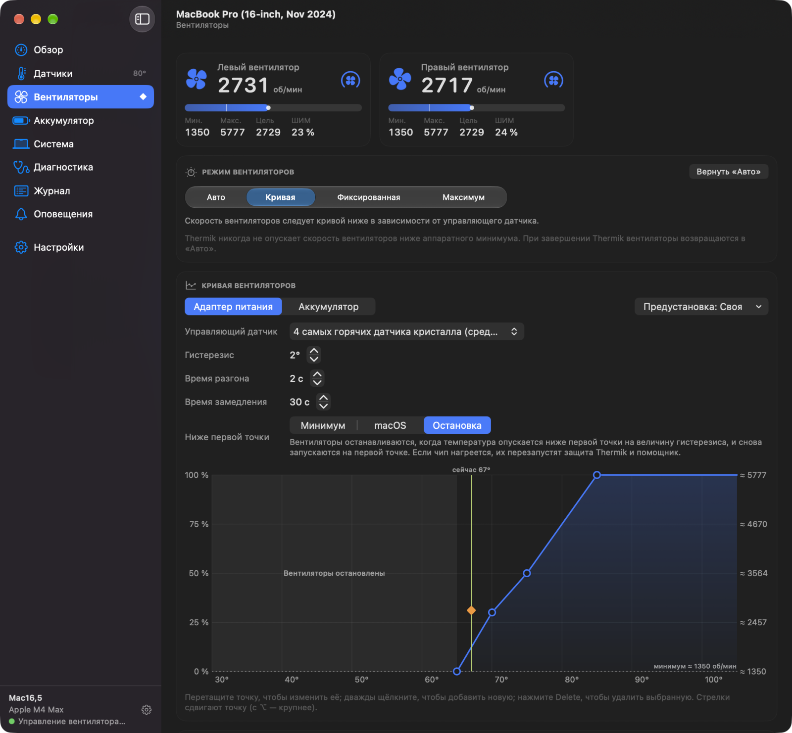</p>

### Датчики

Для каждого датчика — текущее значение, минимум, среднее, максимум и график за 5 минут. Инспектор справа
показывает историю и технические подробности выбранного датчика.

<p align="center">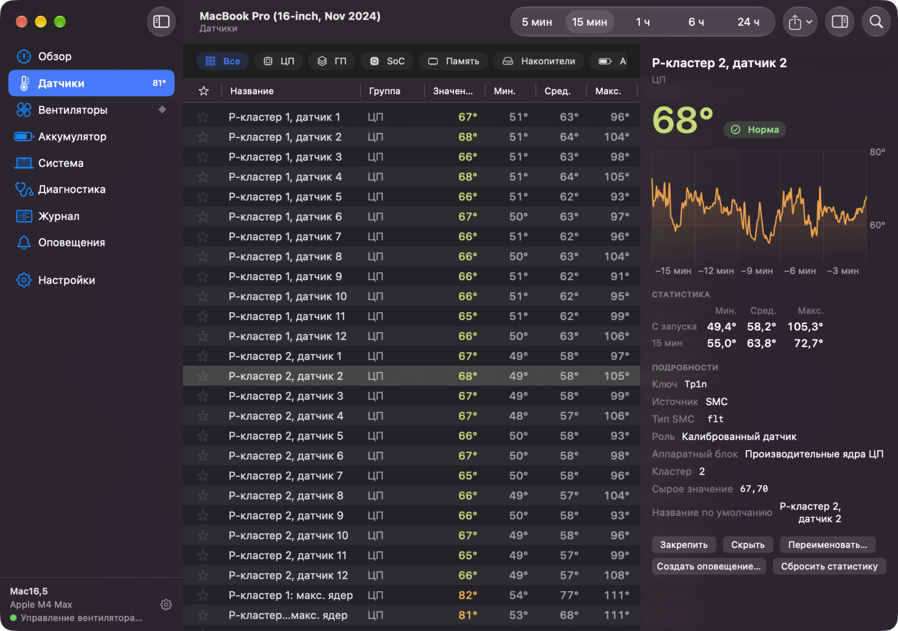</p>

### Строка меню — как вам удобно

Каждый стиль показан на живых данных вашего Mac. В «Своём варианте» можно собрать любые датчики, вентиляторы и
показатели мощности, выбрать к ним значки и короткие подписи (до четырёх символов).

<p align="center">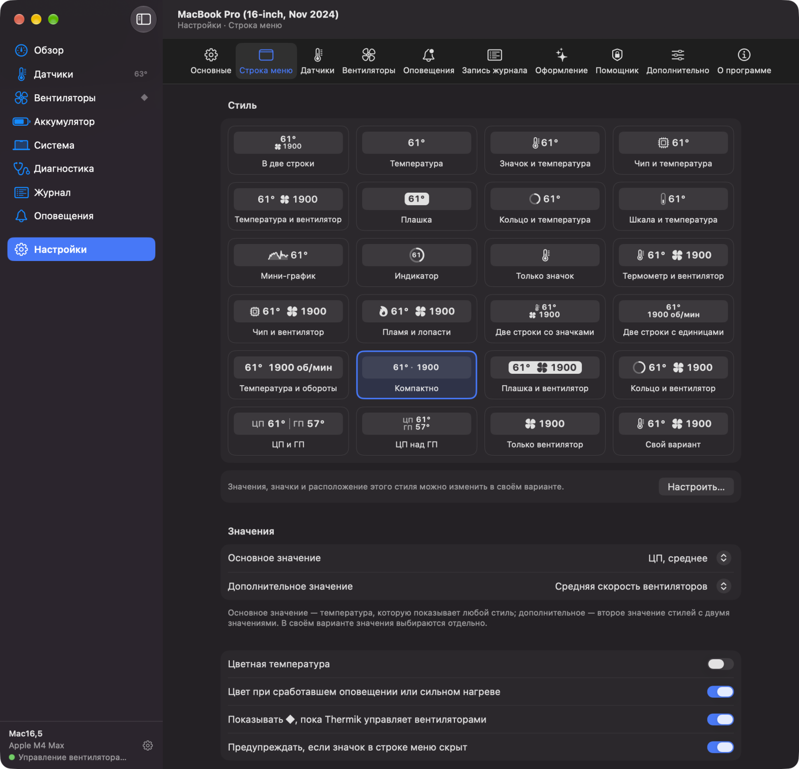</p>

### Аккумулятор и система

<p align="center">
  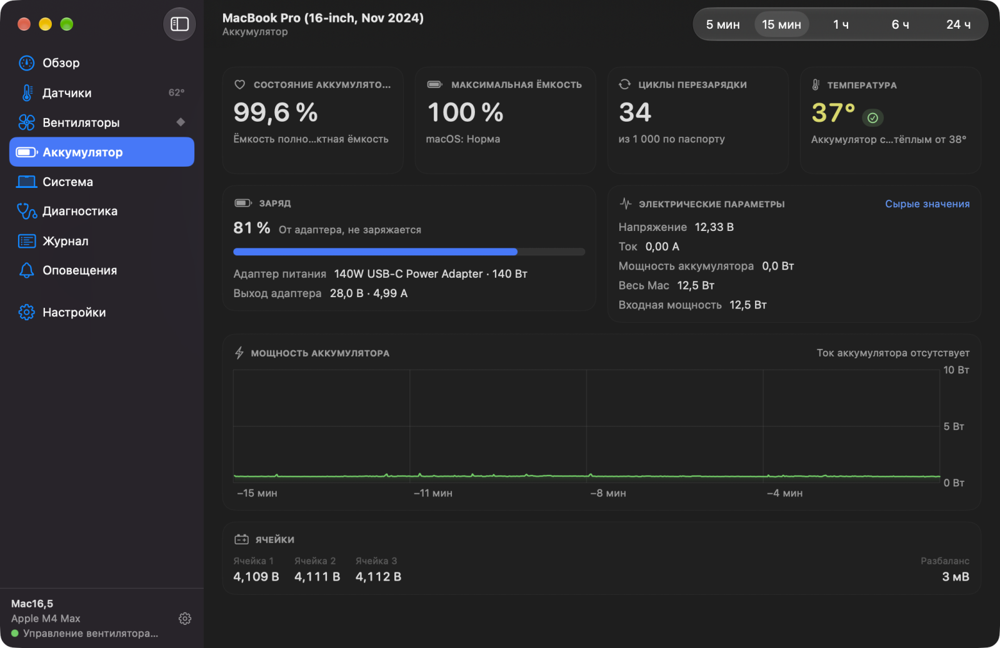
  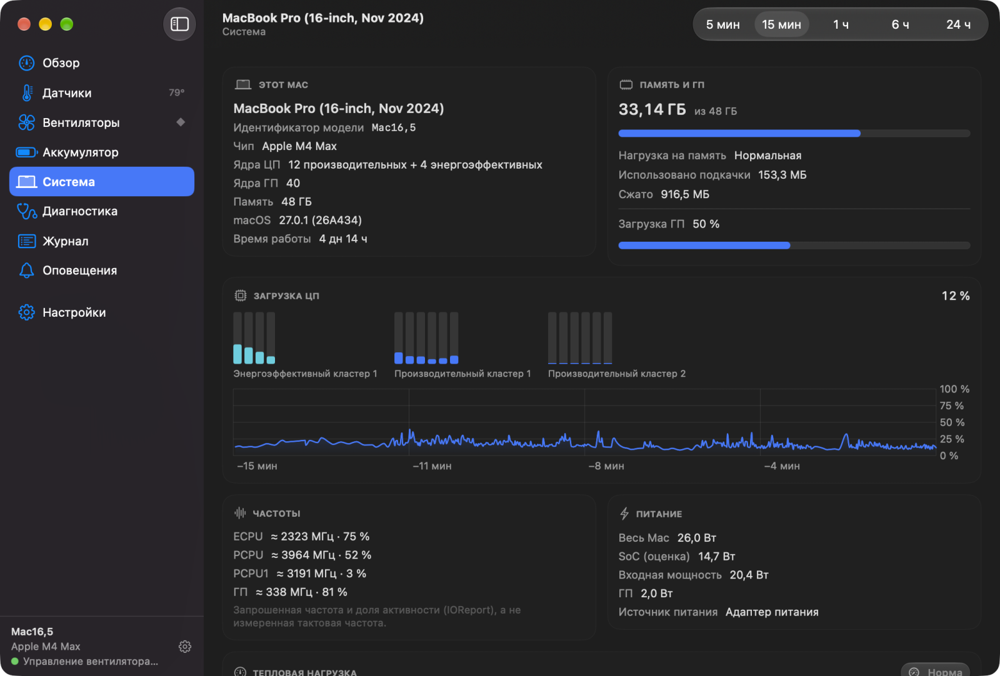
</p>

### Диагностика

Проверки выполняются на вашем Mac и объясняют результат простыми словами. Там же — 10-секундная проверка
вентиляторов и история сна и пробуждения macOS.

<p align="center">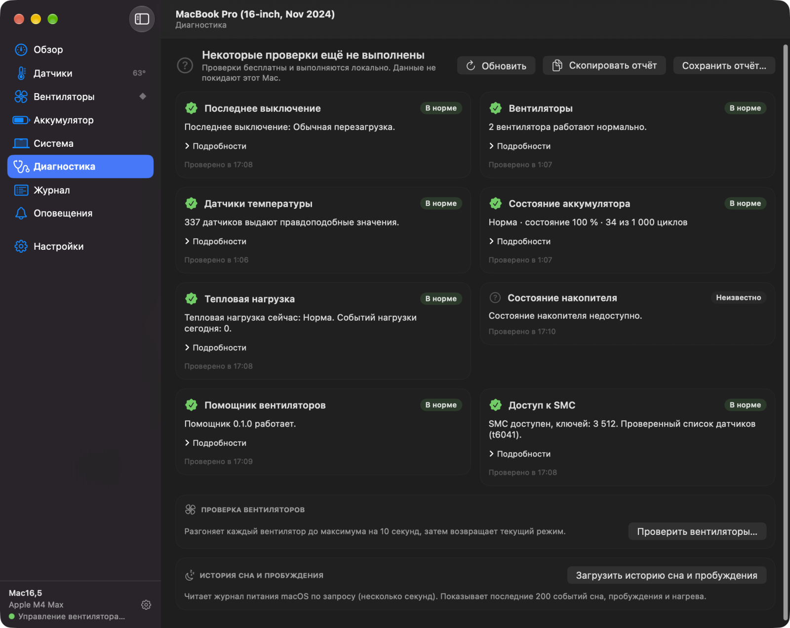</p>

### Оповещения и цвета

Семь готовых правил оповещений; все выключены, пока вы не включите нужные. Каждая температура окрашивается по
шкале, которую можно настроить; есть и шкала для людей с нарушением цветовосприятия.

<p align="center">
  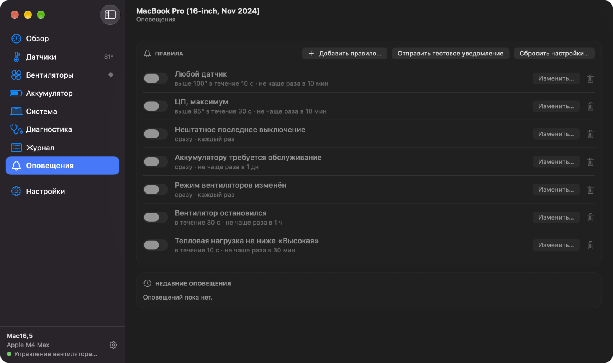
  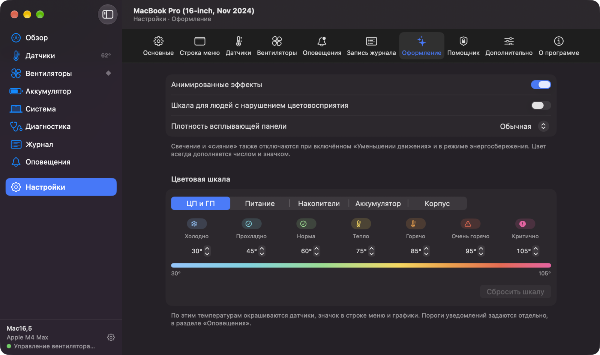
</p>

## Безопасность

- Для мониторинга не нужны никакие разрешения. Только для управления вентиляторами нужен небольшой помощник с
  открытым кодом; для его установки достаточно один раз ввести пароль администратора.
- Если Thermik завершается, падает, зависает или Mac уходит в сон, вентиляторы возвращаются под управление
  macOS.
- В режимах «Кривая», «Фиксированная» и «Максимум» вентиляторы сразу выходят на полную скорость, когда среднее
  четырёх самых горячих датчиков кристалла достигает 100 °C (или любой из них — 105 °C). У помощника есть
  собственная резервная защита, которая работает, даже если приложение зависло.
- Thermik не конфликтует с другими программами управления вентиляторами: он переходит в «Авто» и, если может
  определить программу, показывает, какая из них сейчас управляет вентиляторами.
- Каждый запуск начинается в режиме «Авто», если не включён параметр «Восстанавливать последний режим
  вентиляторов при запуске».

## Как получить

Thermik работает на macOS 14 и новее. Скачайте `Thermik-<версия>.zip` из [последнего релиза](../../releases/latest),
распакуйте и перенесите Thermik.app в «Программы». Приложение подписано ad-hoc и не нотаризовано, поэтому первый
запуск macOS заблокирует: откройте его один раз, затем разрешите в «Системных настройках» › «Конфиденциальность и
безопасность» › «Все равно открыть».

Чтобы собрать Thermik из исходников, нужны Xcode 27.1 или новее и [XcodeGen](https://github.com/yonaskolb/XcodeGen)
2.46.0 или новее.

```sh
brew install xcodegen
scripts/lib/build.sh Release
open build/DerivedData/Build/Products/Release/Thermik.app
```

Учётная запись разработчика Apple не нужна. Чтобы осмотреться, не трогая оборудование, запустите демо-режим:
`open …/Thermik.app --args -ThermikDemo YES`. Всё о сборке, подписи и помощнике — в
[руководстве разработчика](docs/development.md) (на английском).

## Статус

Thermik активно развивается. Проверенные названия датчиков есть для Apple M4 Max. На других Mac с Apple
Silicon названия датчиков приблизительные, Intel поддерживается по мере сил. Сообщения об ошибках с
приложенным отчётом диагностики очень помогают.

## Конфиденциальность

В Thermik нет телеметрии, аналитики и вообще сетевого кода. Показания датчиков, настройки и журналы остаются на
вашем Mac.

## Правовая оговорка

Thermik — независимый проект. Он не связан с Tunabelly Software и TG Pro, не одобрен ими и не основан на их
продуктах. Приложение написано по принципу «чистой комнаты»: код и ресурсы проприетарных программ не
использовались.

[MIT](LICENSE) © 2026 Thermik contributors.
